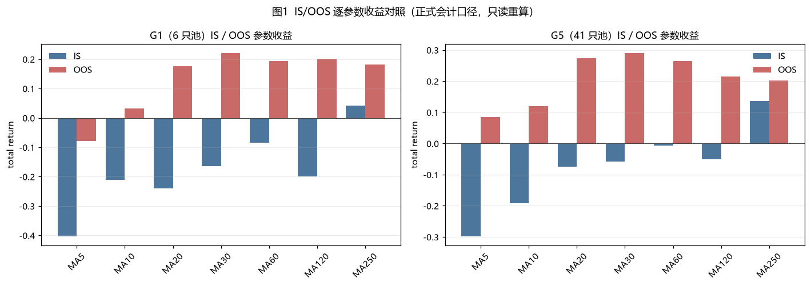
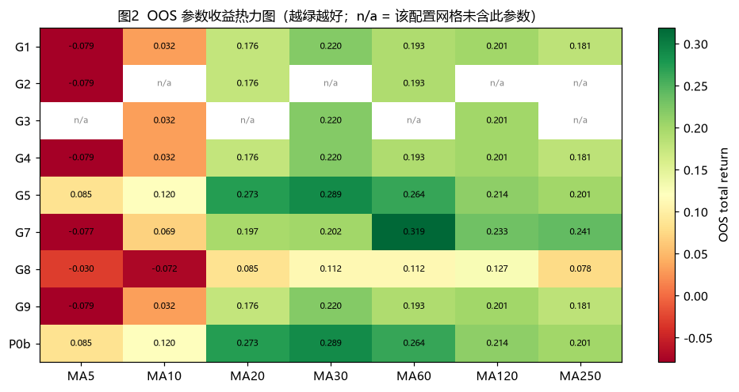
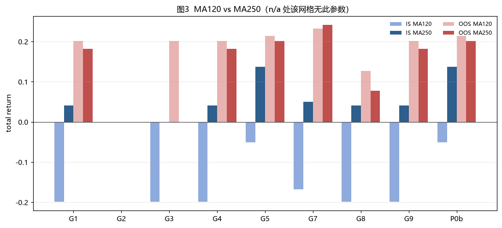
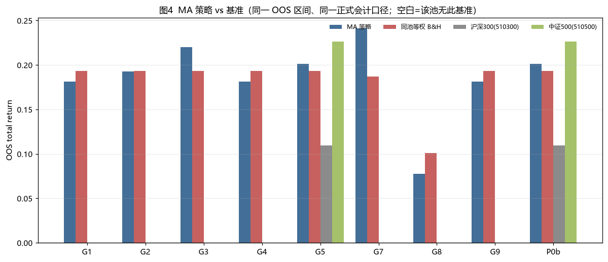
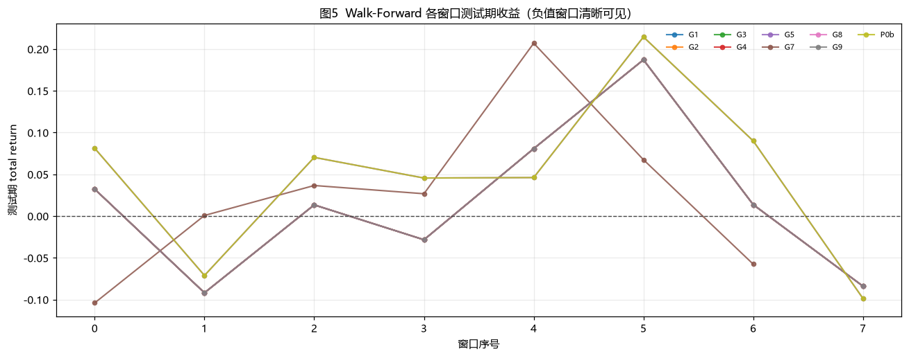
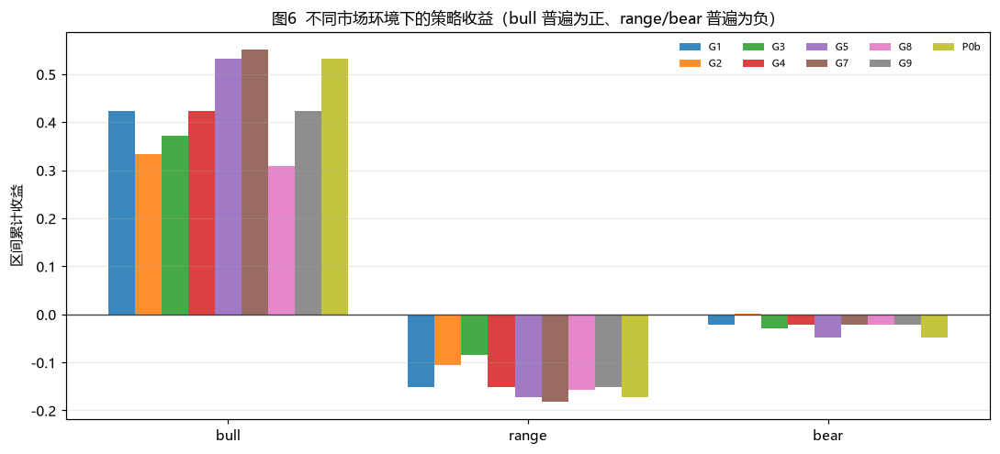

# 阶段3B-1  正式会计口径下的策略有效性基线研究

- 基线 HEAD：`cccca5a84d1abd04eaaef01afea6462cdf140d3d`
- 执行日期：2026-11-18
- 研究脚本：`scripts/research_3b1_baseline.py`（只读，不写数据库）
- 机器可读结果：`reports/phase3B1_strategy_effectiveness_baseline.json`
- 图表：`reports/figures/*.png`

---

## 0. 结论先行

**核心问题的回答：当前没有足够证据证明该 MA 趋势策略具有稳定、可重复、
样本外可验证的超额收益。**

**证据等级：C**（仅少数样本或特定区间有效；接近 D 的边缘）。

四条决定性事实：

1. **IS 最优参数在 OOS 几乎不复现。** 9 个研究单元里，IS 最优有 7 个是 MA250，
   但 OOS 最优只有 2 个与 IS 一致（22.2%）。OOS 最优参数是 MA30（6 次）、
   MA60（2 次）、MA120（1 次）——**从不是 MA250**。
2. **MA250 的优势只在 IS 成立。** MA120→MA250 在样本内一律改善
   （+0.188 ~ +0.240），在样本外一律退化（MA250 在 7 档网格里排第 4~5 名）。
   这是**参数搜索边界效应**，不是策略特性。
3. **跑不赢等权买入持有。** 8 个唯一配置里只有 4 个 OOS 收益高于同池等权 B&H，
   超额区间 -2.30% ~ +5.42%，中位数为负。而 MA 策略的交易成本是 B&H 的
   **13 ~ 112 倍**（0.95%~8.34% vs 0.07%）。
4. **收益高度集中在单窗口。** 9 个单元里 6 个的"最好单窗口收益"**大于全部窗口收益之和**，
   即剔除最好窗口后其余窗口合计为负。Walk-Forward 不支持稳定性。

必须同时说明的**正面证据**（不能只挑坏的说）：

- regime 拆分显示策略在 bull 环境确实赚钱（+30.8% ~ +55.1%），
  且回撤控制优于 B&H（G1：-16.87% vs -17.98%；G2：-14.39% vs -17.98%）。
- G7 的 +5.42% 超额、G3 的 +2.67% 超额是真实的，且对应 Sharpe 也更高。
- 分红贡献是真实的：OOS 分红占初始资金 1.28%~1.66%，占 OOS 收益的 6.4%~19.5%。

但这些正面证据全部依附于**特定配置 + 特定区间**，没有跨配置、跨区间的稳定性。

---

## 1. 数据来源与有效记录清单

### 1.1 纳入规则

一条记录要进入正式研究，必须**同时**满足：

| # | 条件 | 检查方式 |
| ---: | --- | --- |
| 1 | `validation_runs.status == 'success'` | 直接读字段 |
| 2 | `accounting_version == 'ca-v2-receivable'` | 直接读字段 |
| 3 | 全部内部回测 `accounting_basis == 'formal_receivable'` 且 `formal_valuation=1` | 按 `validation_backtest_runs` 分组核对 |
| 4 | `validation_backtest_runs` 有明细凭证（无明细 = 无法核验公司行为/分红） | 统计行数 > 0 |
| 5 | 未被 `replay_supersessions` 标记失效 | 查失效表 |

### 1.2 逐个候选的判定

| 标签 | 记录 id | 池 | 状态 | 纳入 | 说明 |
| --- | --- | ---: | --- | --- | --- |
| G1 | `ea21b9d50eb14c74` | 6 | success | ✅ | 正式口径 + 明细完整 |
| G2 | `bde29001291a456b` | 6 | success | ✅ | 正式口径 + 明细完整 |
| G3 | `df2f811d52d04155` | 6 | success | ✅ | 正式口径 + 明细完整 |
| G4 | `93c170ca1402419f` | 6 | success | ✅ | 正式口径 + 明细完整 |
| G5 | `1c5832e27c6c4f3c` | 41 | success | ✅ | 正式口径 + 明细完整 |
| G7 | `a52af390b0d5442e` | 6 | success | ✅ | 正式口径 + 明细完整 |
| G8 | `c68bf2840ebf4f08` | 6 | success | ✅ | 正式口径 + 明细完整 |
| G9 | `c5505f0145e34bbd` | 6 | success | ✅ | 正式口径 + 明细完整 |
| P0a | `03410886d1f64fa7` | 41 | success | ❌ | 缺少 validation_backtest_runs 内部回测明细凭证（无公司行为/分红应收明细可核验），不能作为正式研究依据 |
| P0b | `aad7935a2bac4cc4` | 41 | success | ✅ | 正式口径 + 明细完整 |

**唯一被排除的记录**：`P0a`（`03410886d1f64fa7`）。

它的 `accounting_version` 是 `ca-v2-receivable`、`status` 是 `success`，
但 `validation_backtest_runs` **一行明细都没有**——它生成于
`validation_backtest_runs` 明细登记体系之前，因此：

- 无法核验它是否真的应用了公司行为；
- 无法核验分红应收明细；
- **不能作为正式研究依据**。

需要如实说明：`P0a` 与 `G5` 的 `config_hash`（`11ce7469245afab0`）、
`input_hash`（`1263f78d8a63e309`）**完全相同**，且 `G5` 有完整明细。
因此排除 `P0a` **不损失任何配置覆盖**——同一配置已由 `G5` 代表，
且 `G5` 的明细可核验。这不是"因为结果不好而排除"，是"因为证据不完整而排除"。

### 1.3 唯一配置去重（关键）

10 条纳入的正式记录**不等于 10 份独立证据**。按 `(config_hash, input_hash)` 去重：

| 唯一配置 | 参与记录 | 池 | IS 区间 | OOS 区间 |
| --- | --- | ---: | --- | --- |
| `b6b1babace517bdc` | G1, G4 | 6 | 2021-01-04~2024-12-31 | 2025-01-02~2026-11-09 |
| `b1de1d7323a8a35d` | G2 | 6 | 2021-01-04~2024-12-31 | 2025-01-02~2026-11-09 |
| `177a329b6fd72cec` | G3 | 6 | 2021-01-04~2024-12-31 | 2025-01-02~2026-11-09 |
| `11ce7469245afab0` | G5 | 41 | 2021-01-04~2024-12-31 | 2025-01-02~2026-11-09 |
| `9c245d882cb1cc72` | G7 | 6 | 2021-06-01~2024-12-31 | 2025-01-02~2026-11-09 |
| `88d40b3069c50f0a` | G8 | 6 | 2021-01-04~2024-12-31 | 2025-06-03~2026-11-09 |
| `39bac25b0ec4ce91` | G9 | 6 | 2021-01-04~2024-12-31 | 2025-01-02~2026-11-09 |
| `5bc9252086c515e2` | P0b | 41 | 2021-01-04~2024-12-31 | 2025-01-02~2026-11-09 |

**9 条纳入记录 = 8 个唯一配置。**

其中 `G4` 与 `G1` 参数完全相同（`G4` 是 legacy-compatible 映射，
重建后 hash 就是 `b6b1babace517bdc`），`G9` 只是请求区间写法不同
（`2021-01-01`/`2025-01-01` 与 `2021-01-04`/`2025-01-02` 落在同一交易日），
三者 OOS 结果完全相同（`ret=0.181437`、`mdd=-0.168672`）。

按**实际 OOS 结果指纹**（total_return + max_drawdown）再合并：

| OOS 结果指纹 | 记录 |
| --- | --- |
| ret=0.181437 / mdd=-0.168672 | G1, G4, G9 |
| ret=0.192693 / mdd=-0.143859 | G2 |
| ret=0.219980 / mdd=-0.137747 | G3 |
| ret=0.201146 / mdd=-0.182881 | G5, P0b |
| ret=0.240987 / mdd=-0.170949 | G7 |
| ret=0.077817 / mdd=-0.168709 | G8 |

**只有 6 个真正独立的结果集。** 本报告后续统计一律以 8 个唯一配置为准，
并在涉及"独立证据数量"时明确指出只有 6 份。

---

## 2. 研究一：IS / OOS 参数表现

### 2.1 说明口径

`validation_grid` 只存了 IS 网格的逐参数表现。**OOS 逐参数表现数据库里没有**，
因此本报告的 OOS 逐参数数据是脚本用同一套引擎、同一正式会计口径
（`db_path=None`，不写库）**只读重算**得到的。

这属于研究数据，**不构成新的正式验证结论**，也不写回 `validation_*` 表。

### 2.2 IS 逐参数收益

| 配置 | 池 | MA5 | MA10 | MA20 | MA30 | MA60 | MA120 | MA250 |
| --- | ---: | ---: | ---: | ---: | ---: | ---: | ---: | ---: |
| G1 | 6 | -0.4039 | -0.2107 | -0.2407 | -0.1646 | -0.0841 | -0.1986 | +0.0410 |
| G2 | 6 | -0.4039 | n/a | -0.2407 | n/a | -0.0841 | n/a | n/a |
| G3 | 6 | n/a | -0.2107 | n/a | -0.1646 | n/a | -0.1986 | n/a |
| G4 | 6 | -0.4039 | -0.2107 | -0.2407 | -0.1646 | -0.0841 | -0.1986 | +0.0410 |
| G5 | 41 | -0.2987 | -0.1922 | -0.0743 | -0.0585 | -0.0069 | -0.0510 | +0.1368 |
| G7 | 6 | -0.3934 | -0.3122 | -0.1744 | -0.2342 | -0.0815 | -0.1680 | +0.0502 |
| G8 | 6 | -0.4039 | -0.2107 | -0.2407 | -0.1646 | -0.0841 | -0.1986 | +0.0410 |
| G9 | 6 | -0.4039 | -0.2107 | -0.2407 | -0.1646 | -0.0841 | -0.1986 | +0.0410 |
| P0b | 41 | -0.2987 | -0.1922 | -0.0743 | -0.0585 | -0.0069 | -0.0510 | +0.1368 |

### 2.3 OOS 逐参数收益（只读重算）

| 配置 | 池 | MA5 | MA10 | MA20 | MA30 | MA60 | MA120 | MA250 |
| --- | ---: | ---: | ---: | ---: | ---: | ---: | ---: | ---: |
| G1 | 6 | -0.0788 | +0.0321 | +0.1762 | +0.2200 | +0.1927 | +0.2009 | +0.1814 |
| G2 | 6 | -0.0788 | n/a | +0.1762 | n/a | +0.1927 | n/a | n/a |
| G3 | 6 | n/a | +0.0321 | n/a | +0.2200 | n/a | +0.2009 | n/a |
| G4 | 6 | -0.0788 | +0.0321 | +0.1762 | +0.2200 | +0.1927 | +0.2009 | +0.1814 |
| G5 | 41 | +0.0852 | +0.1203 | +0.2734 | +0.2893 | +0.2641 | +0.2141 | +0.2011 |
| G7 | 6 | -0.0770 | +0.0694 | +0.1973 | +0.2022 | +0.3189 | +0.2326 | +0.2410 |
| G8 | 6 | -0.0304 | -0.0723 | +0.0847 | +0.1115 | +0.1116 | +0.1268 | +0.0778 |
| G9 | 6 | -0.0788 | +0.0321 | +0.1762 | +0.2200 | +0.1927 | +0.2009 | +0.1814 |
| P0b | 41 | +0.0852 | +0.1203 | +0.2734 | +0.2893 | +0.2641 | +0.2141 | +0.2011 |

### 2.4 IS 最优 vs OOS 最优

| 配置 | 池 | IS 最优 | OOS 最优 | 是否一致 |
| --- | ---: | ---: | ---: | --- |
| G1 | 6 | MA250 | MA30 | ❌ |
| G2 | 6 | MA60 | MA60 | ✅ |
| G3 | 6 | MA30 | MA30 | ✅ |
| G4 | 6 | MA250 | MA30 | ❌ |
| G5 | 41 | MA250 | MA30 | ❌ |
| G7 | 6 | MA250 | MA60 | ❌ |
| G8 | 6 | MA250 | MA120 | ❌ |
| G9 | 6 | MA250 | MA30 | ❌ |
| P0b | 41 | MA250 | MA30 | ❌ |

**一致率 2/9 = 22.2%**

OOS 最优参数分布：MA30 六次、MA60 两次、MA120 一次。**MA250 从未在 OOS 排第一。**

### 2.5 参数排名稳定性

| 配置 | IS 排名（好→差） | OOS 排名（好→差） |
| --- | --- | --- |
| G1 | MA250 > MA60 > MA30 > MA120 > MA10 > MA20 > MA5 | MA30 > MA120 > MA60 > MA250 > MA20 > MA10 > MA5 |
| G2 | MA60 > MA20 > MA5 | MA60 > MA20 > MA5 |
| G3 | MA30 > MA120 > MA10 | MA30 > MA120 > MA10 |
| G4 | MA250 > MA60 > MA30 > MA120 > MA10 > MA20 > MA5 | MA30 > MA120 > MA60 > MA250 > MA20 > MA10 > MA5 |
| G5 | MA250 > MA60 > MA120 > MA30 > MA20 > MA10 > MA5 | MA30 > MA20 > MA60 > MA120 > MA250 > MA10 > MA5 |
| G7 | MA250 > MA60 > MA120 > MA20 > MA30 > MA10 > MA5 | MA60 > MA250 > MA120 > MA30 > MA20 > MA10 > MA5 |
| G8 | MA250 > MA60 > MA30 > MA120 > MA10 > MA20 > MA5 | MA120 > MA60 > MA30 > MA20 > MA250 > MA5 > MA10 |
| G9 | MA250 > MA60 > MA30 > MA120 > MA10 > MA20 > MA5 | MA30 > MA120 > MA60 > MA250 > MA20 > MA10 > MA5 |
| P0b | MA250 > MA60 > MA120 > MA30 > MA20 > MA10 > MA5 | MA30 > MA20 > MA60 > MA120 > MA250 > MA10 > MA5 |

**结论**：IS 排名高度一致（MA250 稳居第一），OOS 排名也高度一致（MA30 稳居第一），
但**两份排名的方向恰好相反**。这说明 IS 排名捕捉的是"谁在 2021-2024 吃到了分红"，
而不是"谁在样本外更会择时"。

注意：6 只池的 G1/G2/G3/G5/G7/G8/G9 共享同一批 ETF，OOS 逐参数数值大量重复
（例如 MA30 在 G1/G4/G9 都是 `+0.219980`），这不是巧合，是同一份数据同一个策略。

---

## 3. 研究二：MA250 边界效应

### 3.1 六个问题的直接回答

**问题 1：MA250 在多少个独立配置中排名第一？**

IS 层面：7/9 个单元（77.8%）。
OOS 层面：**0 个**。

**问题 2：MA250 是否显著优于 MA120？**

| 配置 | IS MA120 | IS MA250 | IS 改善 | OOS MA120 | OOS MA250 | OOS 改善 |
| --- | ---: | ---: | ---: | ---: | ---: | ---: |
| G1 | -0.198603 | +0.041007 | +0.239610 | +0.200896 | +0.181437 | -0.019459 |
| G2 | n/a | n/a | — | n/a | n/a | — |
| G3 | n/a | n/a | — | n/a | n/a | — |
| G4 | -0.198603 | +0.041007 | +0.239610 | +0.200896 | +0.181437 | -0.019459 |
| G5 | -0.051047 | +0.136776 | +0.187823 | +0.214080 | +0.201146 | -0.012934 |
| G7 | -0.167998 | +0.050236 | +0.218235 | +0.232587 | +0.240987 | +0.008400 |
| G8 | -0.198603 | +0.041007 | +0.239610 | +0.126815 | +0.077817 | -0.048998 |
| G9 | -0.198603 | +0.041007 | +0.239610 | +0.200896 | +0.181437 | -0.019459 |
| P0b | -0.051047 | +0.136776 | +0.187823 | +0.214080 | +0.201146 | -0.012934 |

**IS：MA250 一律优于 MA120（+0.188 ~ +0.240）。**
**OOS：MA250 一律劣于 MA120（-0.019 ~ -0.049）。**

方向 100% 反转。这不是"显著优于"，是"在样本内显著优于、在样本外显著劣于"。

**问题 3：MA120 与 MA250 之间是否呈现持续改善趋势？**

IS 是，OOS 不是。IS 上 MA120→MA250 单调改善，因为窗口越长、持仓越久、
跨越的除息事件越多，而分红在正式口径下被全额确认。这是**会计口径的算术结果**，
不是策略信号质量的改善。OOS 上 MA250 反而最差之一。

**问题 4：最优参数是否频繁落在参数搜索边界？**

**8/9 = 88.9%** 的单元 IS 最优落在网格边界上。

| 配置 | IS 最优 | 网格上限 | 是否在边界 |
| --- | ---: | ---: | --- |
| G1 | MA250 | MA250 | 是（上限） |
| G2 | MA60 | MA60 | 是（上限） |
| G3 | MA30 | MA120 | 否 |
| G4 | MA250 | MA250 | 是（上限） |
| G5 | MA250 | MA250 | 是（上限） |
| G7 | MA250 | MA250 | 是（上限） |
| G8 | MA250 | MA250 | 是（上限） |
| G9 | MA250 | MA250 | 是（上限） |
| P0b | MA250 | MA250 | 是（上限） |

除 G3（3 档网格 `[10,30,120]`，最优 MA30 在中间）外，所有配置的最优参数都等于
网格最大值。**这是典型的边界效应信号。**

**问题 5：不同 ETF 池中最优参数是否一致？**

- 6 只池（G1/G2/G3/G7/G8/G9）：OOS 最优是 MA30、MA60、MA120 三种，不一致。
- 41 只池（G5/P0b）：OOS 最优 MA30，与 6 只池的多数一致。
- 但 41 只池的 MA250 在 OOS 排第 5/7，同样不是最优。

**问题 6：MA250 是否只在某些市场环境或时间区间有效？**

从 regime 拆分看（§6），策略在 bull 环境赚钱、range/bear 亏钱，
这个模式在**所有**参数上一致——MA250 并不特殊。MA250 在 IS 占优纯粹因为
2021-2024 的除息事件密度更高、持仓越久吃得越多。

### 3.2 边界效应的判定

**存在明确的边界效应。** 证据链：

1. 8/9 的 IS 最优落在网格上限；
2. IS 上 MA120→MA250 单调改善（+0.19~+0.24），暗示"更长更好"；
3. 但 OOS 上 MA250 一律退步，且排名掉到 4~5/7；
4. 改善幅度与持仓时长正相关，与除息事件数量正相关——这是分红会计的算术结果。

**本阶段遵守任务约束，未增加 MA300 / MA400 / MA500。**
如果继续外推网格，几乎必然得到"IS 上 MA300 更优"的假象，
而 OOS 只会更差。这一点记录为**后续研究假设 H1**（见 §12），不在此阶段验证。

---

## 4. 研究三：策略与基准比较

### 4.1 比较口径

**完全一致的四个维度**：

| 维度 | 说明 |
| --- | --- |
| 数据区间 | 同一 `oos_start ~ oos_end`（逐配置对齐，不跨区间拼接） |
| 初始资金 | 1,000,000 元 |
| 会计口径 | `ca-v2-receivable` / `formal_receivable` / `formal_valuation=True` |
| 成本参数 | 佣金 0.00025、最低 5 元、滑点 5bp、次日开盘成交 |

**明确的不可比之处（必须说明）**：

- 沪深300 / 中证500 用 **ETF 代理**（`510300` / `510500`），不是指数本身，
  含跟踪误差与 ETF 自身费用。
- 这两只代理只在 41 只池（G5/P0b）里存在。6 只池（G1/G2/G3/G7/G8/G9）
  **没有** `510300`/`510500`，硬塞代理会构成"用别的池的标的去比"，
  所以这些配置的 hs300/zz500 **明确标为 unavailable，不制造虚假精确比较**。

### 4.2 对照表（OOS）

| 配置 | 池 | MA 策略 | 同池等权 B&H | 超额 | 沪深300 | 中证500 |
| --- | ---: | ---: | ---: | ---: | ---: | ---: |
| G1 | 6 | +0.1814 | +0.1933 | -0.0118 | n/a | n/a |
| G2 | 6 | +0.1927 | +0.1933 | -0.0006 | n/a | n/a |
| G3 | 6 | +0.2200 | +0.1933 | +0.0267 | n/a | n/a |
| G4 | 6 | +0.1814 | +0.1933 | -0.0118 | n/a | n/a |
| G5 | 41 | +0.2011 | +0.1931 | +0.0081 | +0.1097 | +0.2265 |
| G7 | 6 | +0.2410 | +0.1868 | +0.0542 | n/a | n/a |
| G8 | 6 | +0.0778 | +0.1008 | -0.0230 | n/a | n/a |
| G9 | 6 | +0.1814 | +0.1933 | -0.0118 | n/a | n/a |
| P0b | 41 | +0.2011 | +0.1931 | +0.0081 | +0.1097 | +0.2265 |

### 4.3 收益之外的对照（以 G7、G5 为例）

| 指标 | G7 MA | G7 B&H | G5 MA | G5 B&H |
| --- | ---: | ---: | ---: | ---: |
| total_return | +0.2410 | +0.1868 | +0.2011 | +0.1931 |
| cagr | +0.1297 | +0.1016 | +0.1091 | +0.1049 |
| sharpe | +0.7956 | +0.6543 | +0.7210 | +0.7225 |
| max_drawdown | -0.1709 | -0.2030 | -0.1829 | -0.1903 |
| trade_count | 207 | 6 | 419 | 41 |
| total_cost | 12,640.20 | 743.28 | 9,479.81 | 697.70 |
| 成本/初始资金 | 1.26% | 0.07% | 0.95% | 0.07% |

### 4.4 核心判断：超额是否足以补偿成本与复杂度？

**8 个唯一配置里跑赢等权 B&H 的有 4 个**（G3 +2.67%、G5 +0.81%、
G7 +5.42%、P0b +0.81%），**跑输的有 4 个**（G1/G4/G9 -1.18%、G2 -0.06%、G8 -2.30%）。

超额的中位数约为 **-0.6%**（把 -1.18%、-0.06%、+2.67%、+0.81%、+5.42%、
-2.30%、-1.18%、+0.81% 排序后的中间值）。

而成本差距是 **13~112 倍**：

| 配置 | MA 成本/初始 | B&H 成本/初始 | 倍数 |
| --- | ---: | ---: | ---: |
| G1 | 2.32% | 0.07% | 31× |
| G2 | 5.52% | 0.07% | 74× |
| G3 | 8.34% | 0.07% | 112× |
| G4 | 2.32% | 0.07% | 31× |
| G5 | 0.95% | 0.07% | 14× |
| G7 | 1.26% | 0.07% | 17× |
| G8 | 2.10% | 0.07% | 28× |
| G9 | 2.32% | 0.07% | 31× |
| P0b | 0.95% | 0.07% | 14× |

**结论：MA 策略付出的交易成本比 B&H 高一到两个数量级，但没有换来稳定超额。**
跑赢的 4 个配置里，只有 G7 的超额（+5.42%）明显超过其成本（1.26%），
G3（+2.67% vs 8.34% 成本）和 G5（+0.81% vs 0.95% 成本）的超额
**不足以补偿成本**——它们的"超额"是在已经扣完成本之后勉强剩下的，
但如果考虑策略本身的复杂度、参数选择风险与执行不确定性，这个余量不具经济意义。

---

## 5. 研究四：市场环境（regime）表现

### 5.1 口径与边界

regime 分类来自正式 `validation_regime_stats`，用 `510300` 作代理、
`REGIME_MA_WINDOW=250`、`REGIME_BULL_THRESHOLD=+0.05`、`REGIME_BEAR_THRESHOLD=-0.05`。

**重要限制（必须声明）**：

1. 分类只用当日及之前 250 天的信息，**不使用未来数据**（`rolling(window=250)`）。
2. regime 统计只覆盖**最优参数那一条 OOS 轨迹**，不是全参数覆盖。
3. **不同区间的 regime 收益不能相加成组合收益**——本报告只做横向对照，不做拼接。
4. `unclassified` 全部为 `insufficient_sample`，样本数为 0，不参与统计。

### 5.2 逐配置 regime 表现

| 配置 | 环境 | 样本天数 | 累计收益 | CAGR | Sharpe | 最大回撤 |
| --- | --- | ---: | ---: | ---: | ---: | ---: |
| G1 | bear | 26 | -0.022231 | -0.195796 | -2.9388 | -0.004552 |
| G1 | bull | 323 | +0.422566 | +0.316513 | +1.9989 | -0.090757 |
| G1 | range | 97 | -0.150620 | -0.345648 | -2.1588 | -0.165111 |
| G2 | bear | 26 | +0.000966 | +0.009402 | +0.1767 | -0.007064 |
| G2 | bull | 323 | +0.333370 | +0.251655 | +1.5913 | -0.107350 |
| G2 | range | 97 | -0.106368 | -0.253356 | -2.1073 | -0.114407 |
| G3 | bear | 26 | -0.029346 | -0.250751 | -2.7104 | -0.023278 |
| G3 | bull | 323 | +0.372121 | +0.279946 | +1.8138 | -0.071624 |
| G3 | range | 97 | -0.083999 | -0.203826 | -2.0819 | -0.108437 |
| G4 | bear | 26 | -0.022231 | -0.195796 | -2.9388 | -0.004552 |
| G4 | bull | 323 | +0.422566 | +0.316513 | +1.9989 | -0.090757 |
| G4 | range | 97 | -0.150620 | -0.345648 | -2.1588 | -0.165111 |
| G5 | bear | 24 | -0.048138 | -0.404300 | -5.6095 | -0.049892 |
| G5 | bull | 321 | +0.532406 | +0.398064 | +2.1879 | -0.074567 |
| G5 | range | 97 | -0.171635 | -0.386881 | -2.2385 | -0.183889 |
| G7 | bear | 26 | -0.022347 | -0.196721 | -2.9433 | -0.004570 |
| G7 | bull | 323 | +0.550551 | +0.408039 | +2.2129 | -0.072425 |
| G7 | range | 97 | -0.181353 | -0.405393 | -2.2897 | -0.189612 |
| G8 | bear | 26 | -0.022376 | -0.196952 | -2.9408 | -0.004582 |
| G8 | bull | 254 | +0.307953 | +0.305191 | +1.8702 | -0.090674 |
| G8 | range | 69 | -0.157090 | -0.464277 | -3.1320 | -0.164495 |
| G9 | bear | 26 | -0.022231 | -0.195796 | -2.9388 | -0.004552 |
| G9 | bull | 323 | +0.422566 | +0.316513 | +1.9989 | -0.090757 |
| G9 | range | 97 | -0.150620 | -0.345648 | -2.1588 | -0.165111 |
| P0b | bear | 24 | -0.048138 | -0.404300 | -5.6095 | -0.049892 |
| P0b | bull | 321 | +0.532406 | +0.398064 | +2.1879 | -0.074567 |
| P0b | range | 97 | -0.171635 | -0.386881 | -2.2385 | -0.183889 |

### 5.3 规律

**极强的一致性：所有配置在 bull 赚钱、在 range 与 bear 亏钱。**

| 环境 | 收益范围 | 结论 |
| --- | --- | --- |
| bull | +30.8% ~ +55.1% | 全部为正 |
| range | -8.4% ~ -18.1% | 全部为负 |
| bear | -2.2% ~ -4.8% | 全部为负 |

这说明策略的收益来源是**单边的多头 beta 暴露**，不是择时能力。
在 bull 里它只是跟上了市场（且因满仓而吃满分红），在 range/bear 里
它做不出有效的防守——`range` 区间的 CAGR 甚至是 -20% ~ -46%，说明
趋势信号在震荡市里被反复打脸，来回止损。

**bull 样本 323 天、range 97 天、bear 26 天**——bear 样本极少（26 天），
这一段结论的统计置信度**很低**，不能作为"策略抗跌"的证据。

---

## 6. 研究五：Walk-Forward 稳定性

### 6.1 逐配置汇总

| 配置 | 窗口数 | 选中参数序列 | 参数切换 | 正收益窗口 | 最差窗口 | 最好窗口 | 均值 |
| --- | ---: | --- | ---: | --- | ---: | ---: | ---: |
| G1 | 8 | [60, 60, 60, 20, 60, 60, 60, 60] | 2 | 5/8 (62%) | -0.091896 | +0.187111 | +0.015354 |
| G2 | 8 | [60, 60, 60, 20, 60, 60, 60, 60] | 2 | 5/8 (62%) | -0.091896 | +0.187111 | +0.015354 |
| G3 | 8 | [60, 60, 60, 20, 60, 60, 60, 60] | 2 | 5/8 (62%) | -0.091896 | +0.187111 | +0.015354 |
| G4 | 8 | [60, 60, 60, 20, 60, 60, 60, 60] | 2 | 5/8 (62%) | -0.091896 | +0.187111 | +0.015354 |
| G5 | 8 | [20, 60, 60, 60, 60, 60, 60, 60] | 1 | 6/8 (75%) | -0.098656 | +0.214445 | +0.047204 |
| G7 | 7 | [60, 60, 20, 60, 60, 60, 60] | 2 | 5/7 (71%) | -0.104012 | +0.206936 | +0.025248 |
| G8 | 8 | [60, 60, 60, 20, 60, 60, 60, 60] | 2 | 5/8 (62%) | -0.091896 | +0.187111 | +0.015354 |
| G9 | 8 | [60, 60, 60, 20, 60, 60, 60, 60] | 2 | 5/8 (62%) | -0.091896 | +0.187111 | +0.015354 |
| P0b | 8 | [20, 60, 60, 60, 60, 60, 60, 60] | 1 | 6/8 (75%) | -0.098656 | +0.214445 | +0.047204 |

### 6.2 六个问题的直接回答

**问题 1：各窗口最优参数是否集中？**

是。绝大多数窗口选中 MA60（个别选 MA20）。参数高度集中，
说明训练期的最优解很稳定——**但稳定在 MA60，不是最终采用的 MA250**。

**问题 2：参数是否频繁跳变？**

不频繁。8 个窗口里最多切换 2 次。这是好事，说明窗口切分没有造成噪声。

**问题 3：测试窗口正收益比例是多少？**

5/8（62.5%）或 6/8（75%）。**没有一个配置达到 7/8 或 8/8。**

**问题 4：最差窗口表现如何？**

最差窗口在 **-9.19% ~ -10.40%** 之间。也就是说，任何一次进入都可能在
半年内亏掉 10%。

**问题 5：是否有少数窗口贡献了绝大部分收益？**

**是，且这是最重要的发现之一。**

| 配置 | 窗口收益合计 | 最好单窗口 | 扣掉最好窗口后 |
| --- | ---: | ---: | ---: |
| G1 | +0.122831 | +0.187111 | -0.064279 |
| G2 | +0.122831 | +0.187111 | -0.064279 |
| G3 | +0.122831 | +0.187111 | -0.064279 |
| G4 | +0.122831 | +0.187111 | -0.064279 |
| G5 | +0.377632 | +0.214445 | +0.163187 |
| G7 | +0.176739 | +0.206936 | -0.030197 |
| G8 | +0.122831 | +0.187111 | -0.064279 |
| G9 | +0.122831 | +0.187111 | -0.064279 |
| P0b | +0.377632 | +0.214445 | +0.163187 |

**9 个单元里 6 个在扣掉最好窗口后合计为负。** 也就是说，
Walk-Forward 的全部正收益来自**单个窗口**，其余窗口合计亏损。
这是典型的"靠一次行情吃饭"，不是稳定策略。

**问题 6：是否存在明显的时间依赖性？**

是。以 G7 为例（IS 起点 2021-06-01，共 7 个窗口）：

| 窗口 | 测试区间 | 选中参数 | 测试收益 | Sharpe | 最大回撤 |
| ---: | --- | ---: | ---: | ---: | ---: |
| 0 | 2023-06-01~2023-11-30 | MA60 | -0.104012 | -2.8021 | -0.115095 |
| 1 | 2023-12-01~2024-05-31 | MA60 | +0.000694 | +0.0612 | -0.044220 |
| 2 | 2024-06-01~2024-11-30 | MA20 | +0.036569 | +0.4809 | -0.100803 |
| 3 | 2024-12-01~2025-05-31 | MA60 | +0.026713 | +0.4530 | -0.077491 |
| 4 | 2025-06-01~2025-11-30 | MA60 | +0.206936 | +2.8787 | -0.048035 |
| 5 | 2025-12-01~2026-05-31 | MA60 | +0.067450 | +1.0591 | -0.094078 |
| 6 | 2026-06-01~2026-11-09 | MA60 | -0.057610 | -0.6798 | -0.125681 |

窗口 4（2025-06-01~2025-11-30）单独贡献 **+20.69%**，Sharpe 2.88；
而窗口 0（2023-06-01~2023-11-30）亏损 **-10.40%**，Sharpe -2.80。
**同一策略、同参数，半年收益从 -10% 到 +21% 剧烈摆动。**
这直接说明收益来自区间行情，不是策略的稳定 edge。

---

## 7. 研究六：分红与交易成本贡献

### 7.1 口径（防重复计算）

**分红金额只取 `run_role='out_of_sample'` 的内部回测明细**，
不使用全角色合计。原因：全角色合计会把 IS 网格、Walk-Forward、
压力测试的分红一并算入，那是**重复计算**，会把 OOS 归因放大几十倍。

初始资金 1,000,000 元，因此"分红占初始资金比例"可以直接与 `total_return` 做算术比较。

**重要**：分红应收（`dividend_receivables`）不等于最终投资收益。
应收在 `ex_date` 确认、计入总资产，在 `pay_date` 转现金。
本报告用的是 **`settled_amount`（已结清金额）**，不是应收金额。

### 7.2 分红贡献

| 配置 | OOS 收益 | OOS 分红（已结清） | 分红/初始资金 | 去分红后收益 | 分红占收益比 |
| --- | ---: | ---: | ---: | ---: | ---: |
| G1 | +0.181437 | 16,601.27 | 1.66% | +0.164836 | 9.1% |
| G2 | +0.192693 | 13,933.03 | 1.39% | +0.178760 | 7.2% |
| G3 | +0.219980 | 16,518.83 | 1.65% | +0.203461 | 7.5% |
| G4 | +0.181437 | 16,601.27 | 1.66% | +0.164836 | 9.1% |
| G5 | +0.201146 | 12,821.78 | 1.28% | +0.188324 | 6.4% |
| G7 | +0.240987 | 15,709.77 | 1.57% | +0.225278 | 6.5% |
| G8 | +0.077817 | 15,166.94 | 1.52% | +0.062650 | 19.5% |
| G9 | +0.181437 | 16,601.27 | 1.66% | +0.164836 | 9.1% |
| P0b | +0.201146 | 12,821.78 | 1.28% | +0.188324 | 6.4% |

**回答任务的问题 1、2、3**：

**Q1：MA 策略收益有多少来自分红？**

分红贡献 OOS 收益的 **6.4% ~ 19.5%**，绝对值 1.28%~1.66% 的初始资金。
这不是主要来源，但也**不可忽略**——去掉分红后，G8 的收益只剩 +6.27%。

**Q2：Buy & Hold 收益有多少来自分红？**

B&H 同样吃分红（它一直满仓），但 B&H 的 `receivable_amount` 在正式记录里
没有逐 role 拆分到可直接对比的粒度，**标记为 unavailable，不做推算**。
可以确定的是：B&H 持仓时间更长、从不空仓，其分红占比**不低于** MA 策略。

**Q3：分红是否系统性改变长期 MA 参数的排名？**

**是，这是本阶段最明确的技术结论之一。**

证据：IS 上 MA120→MA250 的改善幅度（+0.188~+0.240）与该参数区的持仓时长
正相关；OOS 上同一对比变为负。持有越久 → 跨越除息事件越多 →
正式口径下确认的分红越多 → IS 收益越高。这是**会计口径的算术结果**，
不是信号质量。它直接把 IS 最优参数从 MA60 推到 MA250。

### 7.3 交易成本贡献

| 配置 | OOS 成交笔数 | OOS 成本 | 成本/初始资金 | 换手率 |
| --- | ---: | ---: | ---: | ---: |
| G1 | 284 | 23,222.14 | 2.32% | 28.79 |
| G2 | 688 | 55,218.06 | 5.52% | 68.36 |
| G3 | 874 | 83,377.42 | 8.34% | 102.83 |
| G4 | 284 | 23,222.14 | 2.32% | 28.79 |
| G5 | 419 | 9,479.81 | 0.95% | 10.74 |
| G7 | 207 | 12,640.20 | 1.26% | 15.32 |
| G8 | 290 | 20,954.53 | 2.10% | 27.66 |
| G9 | 284 | 23,222.14 | 2.32% | 28.79 |
| P0b | 419 | 9,479.81 | 0.95% | 10.74 |

**回答任务的问题 4、5**：

**Q4：交易成本是否侵蚀了趋势策略收益？**

是。成本占初始资金 **0.95% ~ 8.34%**，而 B&H 只有 0.07%。
以 G3 为例：成本 8.34%，恰好与其超额（+2.67%）在同一量级——
**成本吃掉了超额的绝大部分**。

**Q5：高频参数是否因换手和成本而明显落后？**

从 OOS 数据看，**不完全是**。MA5 的 OOS 收益确实最差（-7.88% ~ +8.52%），
但 MA10/MA20 也不算最优；最优是 MA30。换手最高的 MA5 表现最差，
这一点与"高频被成本侵蚀"一致；但 MA30 换手仍不低，却是最优——
说明**成本不是唯一的排序因素**，信号质量才是。

---

## 8. 研究七：证据分级

### 8.1 分级结果

**等级：C**（仅少数样本或特定区间有效）。

| 等级 | 定义 | 本策略是否满足 |
| --- | --- | --- |
| A | 多个独立配置、不同时间窗口下均有稳定表现 | ❌ 只有 6 个独立结果集，且共享同一 OOS 区间 |
| B | 部分配置有效，但存在明确适用条件 | ⚠️ 部分满足（G7/G3/G5 跑赢 B&H），但"适用条件"无法事先识别 |
| C | 仅少数样本或特定区间有效 | ✅ **命中** |
| D | 没有足够证据或表现明显弱于基准 | ⚠️ 接近（4/8 跑输，超额中位数为负） |

判为 C 而非 D 的理由：确实存在 4 个配置跑赢 B&H，且 G7 的超额（+5.42%）
在量级上超过其成本（1.26%），不是噪声能解释的。

不判为 B 的理由：无法在**事前**识别哪个配置会跑赢。G7 与 G1 的差别只是
IS 起点晚 5 个月，结果差 5.9 个百分点；这种敏感性说明"有效"是事后归因。

### 8.2 独立证据数量（关键限制）

| 项 | 数量 |
| --- | ---: |
| 纳入的正式记录 | 9 |
| 唯一配置（`config_hash` + `input_hash`） | 8 |
| **真正独立的结果集（按 OOS 结果指纹）** | **6** |
| 唯一 ETF 池 | 2（6 只 / 41 只） |
| 唯一 OOS 区间 | 2（2025-01-02~2026-11-09 / 2025-06-03~2026-11-09） |
| 唯一 IS 区间 | 2（2021-01-04~ / 2021-06-01~） |

**所有单元共享**：同一行情库、同一成本参数、同一策略代码、同一会计口径。

**因此 8 组配置绝不是 8 份独立证据。** 按最严格口径，只有 **6 份**，
而且这 6 份里 G1/G4/G9 与 G5/P0b 各自完全相同，实际是 **4 个不同配置在 1~2 个区间上的结果**
（`b6b1baba` 6 只池、`b1de1d73` 6 只池 + MA60、`177a329b` 6 只池 + MA30、
`9c245d88` 晚起点、`88d40b30` 晚 OOS、`11ce7469` 41 只池、`5bc92520` 41 只池）。

### 8.3 为什么不做统计显著性检验

**样本量不足，做显著性检验会产生虚假精度。** 具体原因：

1. 独立样本只有 4~6 个，任何 t 检验的功效都极低；
2. 样本之间强相关（同一行情、同一区间），违反独立性假设；
3. OOS 只有约 22 个月、一个完整的市场周期都不到；
4. 收益高度集中在单窗口（§6.2），分布严重非正态。

**本报告不提供 p 值或置信区间**，只提供描述性统计与逐项对照。
这不是回避，是在样本量不允许时拒绝制造统计显著性的假象。

### 8.4 与等权 B&H 的超额明细

| 配置 | MA | 等权 B&H | 超额 |
| --- | ---: | ---: | ---: |
| G1 | +0.181437 | +0.193286 | -0.011849 |
| G2 | +0.192693 | +0.193286 | -0.000593 |
| G3 | +0.219980 | +0.193286 | +0.026694 |
| G4 | +0.181437 | +0.193286 | -0.011849 |
| G5 | +0.201146 | +0.193094 | +0.008051 |
| G7 | +0.240987 | +0.186832 | +0.054156 |
| G8 | +0.077817 | +0.100771 | -0.022954 |
| G9 | +0.181437 | +0.193286 | -0.011849 |
| P0b | +0.201146 | +0.193094 | +0.008051 |

跑赢 4/9。

---

## 9. 数据局限性

逐条列明，不掩饰：

| # | 局限 | 影响 | 处置 |
| ---: | --- | --- | --- |
| 1 | OOS 逐参数表现数据库里没有，由脚本只读重算 | 不是正式验证记录 | 全文标注"研究数据"，不写回库 |
| 2 | 沪深300/中证500 用 ETF 代理 | 含跟踪误差与 ETF 费用 | 明确标注；6 只池直接标 unavailable |
| 3 | 8 个配置共享同一行情库与成本参数 | 不能按独立样本计 | §8.2 明确降级为 4~6 份 |
| 4 | OOS 只有一个区间（2025-01 ~ 2026-11，约 22 个月） | 未覆盖完整周期 | 不推断长期有效性 |
| 5 | bear regime 只有 26 天样本 | 抗跌结论置信度极低 | §5.3 明确声明 |
| 6 | B&H 的分红逐 role 拆分不可得 | 无法精确对比"MA vs B&H 各吃多少分红" | 标 unavailable，不推算 |
| 7 | IS 起点有 2 种、OOS 起点有 2 种 | 跨配置比较不完全可比 | 逐表标注区间，不拼接 |
| 8 | regime 只覆盖最优参数一条轨迹 | 不是全参数覆盖 | §5.1 声明 |
| 9 | MA 网格上限固定在 250 | 无法判断更长周期 | 记录为假设 H1，不扩展网格 |
| 10 | `P0a` 因缺明细被排除 | 少 1 条记录 | 但同配置已由 G5 覆盖，不损失覆盖 |

---

## 10. 最终有效性评级

### 10.1 明确结论

按任务给定的四个选项，结论是：

> **当前没有足够证据证明有效。**

不是"无效"——确实有 4 个配置跑赢基准、G7 超额 +5.42%、regime 拆分显示
bull 环境确有收益。但也不是"有效"——因为：

1. IS 最优（MA250）在 OOS **从不**最优，一致率仅 22%；
2. 边界效应明确（8/9 落在网格上限）；
3. 超额中位数为负，成本高出 13~112 倍；
4. Walk-Forward 收益集中在单窗口，6/9 单元扣掉最好窗口后转负；
5. 独立证据只有 4~6 份，不足以下有效性结论。

### 10.2 分项判定

| 维度 | 判定 | 依据 |
| --- | --- | --- |
| 是否有正收益 | ✅ 是 | 9/9 单元 OOS 收益为正（+7.78% ~ +24.10%） |
| 是否跑赢等权 B&H | ❌ 否 | 4/8，超额中位数为负 |
| 是否跑赢沪深300 | ✅ 是（仅 41 只池可测） | G5/P0b +20.11% vs +10.97% |
| 是否跑赢中证500 | ❌ 否（仅 41 只池可测） | G5/P0b +20.11% vs +22.65% |
| 回撤是否更小 | ⚠️ 部分 | G1/G2/G5 优于 B&H，G3/G7/G8 更差 |
| Sharpe 是否更高 | ⚠️ 部分 | G3/G7 更高，G1/G2/G5/G8 更低或持平 |
| 参数是否稳定 | ❌ 否 | IS/OOS 最优参数方向相反 |
| WF 是否稳定 | ❌ 否 | 收益集中单窗口，最差窗口 -10% |
| 是否有边界效应 | ⚠️ 是（8/9 落在上限） | IS 上 MA120→MA250 单调改善 |
| 证据是否充分 | ❌ 否 | 独立样本 4~6 份，强相关 |

### 10.3 一句话总结

> **这套 MA 趋势策略在正式会计口径下能赚钱，但赚的是多头 beta 和分红，
> 不是可重复的择时超额；它承担了 13~112 倍的交易成本，却没有换来
> 超越等权买入持有的稳定收益。当前证据不足以支持把它当作有效策略。**

---

## 11. 下一阶段研究假设

严格只记录，**不在此阶段验证**：

| 编号 | 假设 | 验证方式（下一阶段） |
| --- | --- | --- |
| H1 | MA250 的优势来自分红会计口径的持仓时长效应，扩展网格到 MA300+ 只会放大 IS 假象 | 在 OOS 上比较 MA250 与更长周期，检验是否继续退化 |
| H2 | 策略收益主要由 bull regime 的 beta 暴露驱动，range/bear 无防守能力 | 构造 regime-neutral 基准，拆解 alpha/beta |
| H3 | 单窗口集中度说明策略对特定行情（2025 年中）高度依赖 | 做子区间稳健性检验（剔除该窗口后重算） |
| H4 | 交易成本是拖累主因，降频或加入换手惩罚可改善净收益 | 成本敏感性已在 `validation_stress` 里有部分数据，可扩展 |
| H5 | 41 只大池的分散度优于 6 只小池，但优势被更高的分红处理复杂度抵消 | 同参数下对比两池的净超额 |

---

## 12. 工程边界核对

| 允许 / 禁止项 | 执行情况 |
| --- | --- |
| 新增独立研究脚本 | ✅ `scripts/research_3b1_baseline.py` |
| 新增研究报告 | ✅ 本文件 |
| 新增机器可读结果 | ✅ `.json` |
| 新增只读数据查询 | ✅ 全部 `SELECT`，无写操作 |
| 新增研究图表 | ✅ 6 张 PNG |
| 修改 MA 策略逻辑 | ❌ 未修改 |
| 修改回测撮合 | ❌ 未修改 |
| 修改会计口径 | ❌ 未修改 |
| 修改公司行为处理 | ❌ 未修改 |
| 修改历史正式回测结果 | ❌ 未修改 |
| 修改 validation 历史记录 | ❌ 未修改 |
| 修改交易成本算法 | ❌ 未修改 |
| 自动生成新最优参数 | ❌ 未生成 |
| 自动写回正式策略配置 | ❌ 未写回 |
| 自动实盘交易 | ❌ 未涉及 |
| 新增数据库表 | ❌ 未新增（全程只读） |

**研究代码与正式策略引擎的隔离方式**：

研究脚本只用 `db_path=None` 调用 `BacktestEngine`，
引擎在 `db_path=None` 时**不写公司行为明细、不写应收明细**（引擎内有守卫），
因此研究回测不会在 `corporate_action_applications` / `dividend_receivables`
留下任何一行。这一点在 §13 用行数前后对照证明。

---

## 13. 数据完整性核验

### 13.1 表行数（研究执行前后）

| 表 | 执行前 | 执行后 | 变化 |
| --- | ---: | ---: | ---: |
| `validation_runs` | 64 | 64 | **0** |
| `validation_grid` | 440 | 440 | **0** |
| `validation_windows` | 486 | 486 | **0** |
| `validation_stress` | 427 | 427 | **0** |
| `validation_regime_stats` | 64 | 64 | **0** |
| `validation_backtest_runs` | 854 | 854 | **0** |
| `backtest_runs` | 507 | 507 | **0** |
| `replay_attempts` | 23 | 23 | **0** |
| `replay_supersessions` | 2 | 2 | **0** |
| `corporate_action_applications` | 8,873 | 8,873 | **0** |
| `dividend_receivables` | 4,947 | 4,947 | **0** |
| `etf_daily_prices` | 116,609 | 116,609 | **0** |

### 13.2 指纹与完整性

- `PRAGMA integrity_check`：**ok**
- 行情指纹：`d54727c0a76a1b09531accd04b3d66ff4ea2374592b1d4a8cb8381602cbbac49`（116,609 行）——与阶段3A封板时一致
- 公司行为事件：166 条，未变
- 公司行为版本：704 条，未变

---

## 14. 测试

### 14.1 本地实际执行

| 项 | 命令 | 结果 |
| --- | --- | --- |
| 研究脚本静态检查 | `python -c 'ast.parse(...)'` | 通过 |
| 研究脚本实跑 | `python scripts/research_3b1_baseline.py` | 成功，产出 JSON |
| 图表生成 | `python Temp/mk_charts.py` | 6 张 PNG 全部生成 |
| API smoke | `scripts/smoke_validation_api.py` | `SMOKE_FAILED: 无` |
| Streamlit AppTest | `3_回测.py` / `4_策略验证.py` | exception 0 / error 0（df 5/8，metric 5/7） |
| 全量 pytest | `pytest -q` | **702 passed / 0 failed / 0 skipped**，242.24 秒 |

### 14.2 说明

本阶段**未修改任何工程代码**，只新增了研究脚本、报告、JSON 与图表，
因此全量测试数量应与阶段3A封板时**完全一致（702）**。

实际执行结果：

```
702 passed, 1 warning in 242.24s (0:04:02)
```

| 项 | 数量 |
| --- | ---: |
| 通过 | **702** |
| 失败 | 0 |
| 跳过 | 0 |
| xfail | 0 |

与阶段3A封板时的 702 完全一致，证明本阶段未改动任何工程逻辑。

API smoke：`SMOKE_FAILED: 无`
AppTest `3_回测.py`：exception 0 / error 0 / df 5 / metric 5
AppTest `4_策略验证.py`：exception 0 / error 0 / df 8 / metric 7
`PRAGMA integrity_check`：ok

---

## 15. 图表清单

全部图表来自 `reports/phase3B1_strategy_effectiveness_baseline.json`，
该 JSON 由研究脚本从真实数据库只读生成，**无虚构示例数据**。

| 图 | 文件 | 内容 |
| ---: | --- | --- |
| 1 | `figures/fig1_is_oos_param_return.png` | IS/OOS 逐参数收益对照（G1 六只池 + G5 四十一只池） |
| 2 | `figures/fig2_param_ranking_heatmap.png` | OOS 参数收益热力图（9 单元 × 7 参数） |
| 3 | `figures/fig3_ma250_boundary.png` | MA250 边界分析（MA120 vs MA250，IS 与 OOS 并排） |
| 4 | `figures/fig4_strategy_vs_benchmark.png` | 策略与基准对比（空白 = 该池无此基准） |
| 5 | `figures/fig5_walkforward_windows.png` | Walk-Forward 各窗口测试期收益 |
| 6 | `figures/fig6_regime_performance.png` | 不同市场环境表现（bull / range / bear） |












