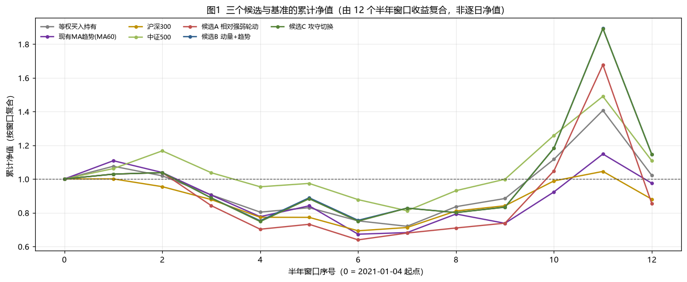
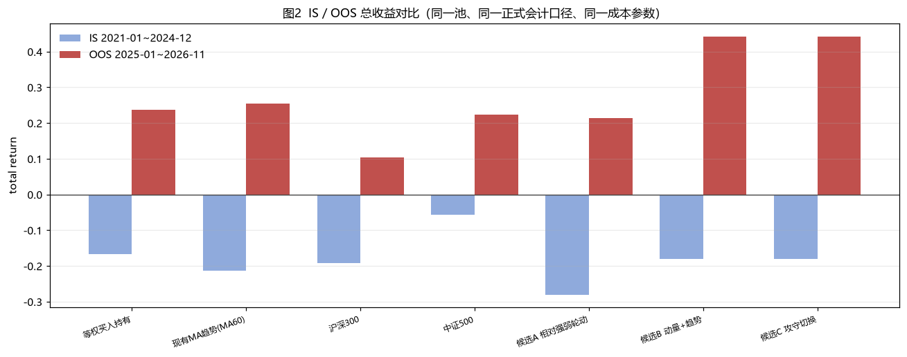
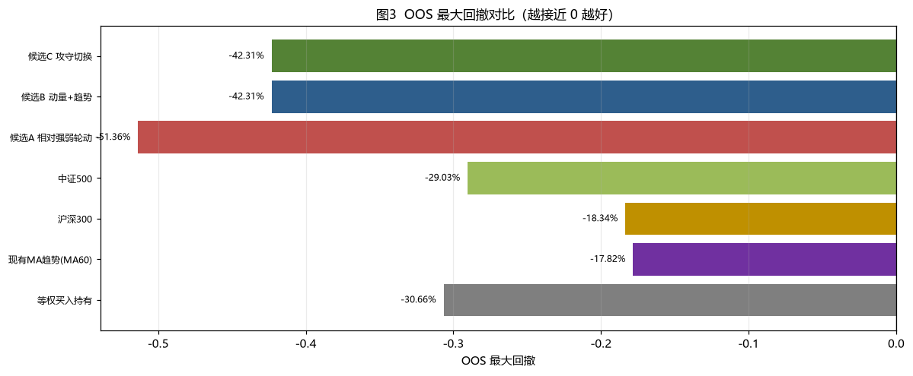
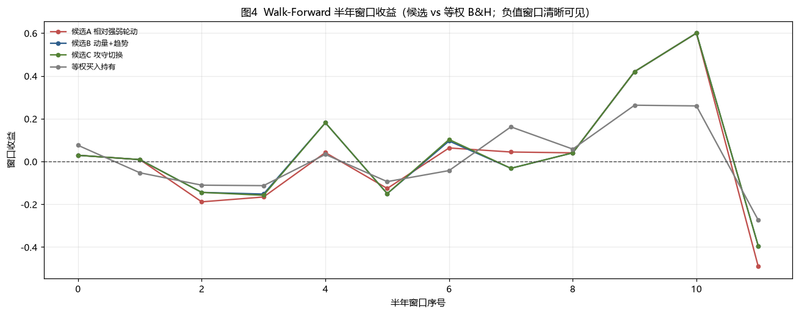
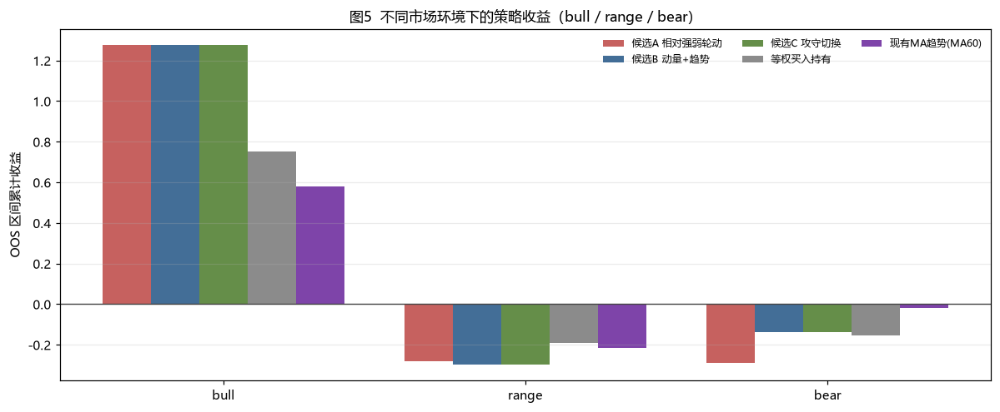
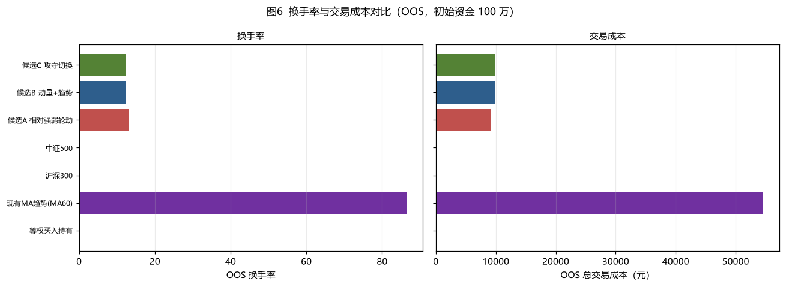

# 阶段3B-2  新策略候选研究与第一轮验证

- 基线 HEAD：`e671d50aeba3900b8bf90140ee6de2bbf469c65a`
- 执行日期：2026-11-19
- 研究脚本：`scripts/research_3b2_candidates.py`（只读，不写数据库）
- 机器可读结果：`reports/phase3B2_strategy_candidates.json`
- 图表：`reports/figures/fig3b2_*.png`（6 张）
- 专项测试：`tests/test_research_3b2_candidates.py`

---

## 0. 结论先行

### 0.1 三个候选的判定

| 候选 | OOS 净收益 | 相对等权 B&H 超额 | 最大回撤 | 是否进下一轮 |
| --- | ---: | ---: | ---: | --- |
| 候选A 相对强弱轮动 | +21.32% | -2.42% | -51.36% | ❌ 不合格 |
| 候选B 动量+趋势过滤 | +44.21% | +20.48% | -42.31% | ❌ 不合格 |
| 候选C 攻守切换 | +44.22% | +20.49% | -42.31% | ❌ 不合格 |

### 0.2 明确结论

> **三个候选全部不合格，不建议进入下一轮正式验证。**

不是因为没有收益——候选B/C 的 OOS 净收益 **+44.21%** 确实很高。
而是因为**收益的来源和稳定性都不成立**：

1. **回撤严重恶化**：候选B/C 的 OOS 最大回撤 **-42.31%**，等权 B&H 是 -30.66%，
   现有 MA 策略只有 **-17.82%**。为了更高的收益承担了近 2.4 倍的深度回撤，
   这不满足「最大回撤不能明显恶化」的硬标准。
2. **收益高度集中在单窗口**：候选B/C 的 12 个半年窗口里，最好一个窗口
   （2026-01-05~2026-06-30）+59.98% **大于全部窗口收益之和**（+49.99%），
   即扣掉这一个窗口后其余 11 个窗口合计 **亏损 -9.99%**。
3. **IS 全线为负**：三个候选在 2021-01~2024-12 的样本内收益分别是
   -28.04%、-18.04%、-18.07%，全部为负。这说明规则不是「在历史上有效」，
   而是「在某一段特定行情里爆发」。

### 0.3 三个候选之间的差异是真实的，但不能当独立证据

候选B 与候选C 的 OOS 收益差 **0.0096%**（+44.2117% vs +44.2213%），
因为候选C 的防守切换**只在 2 个月触发**（2022-11、2024-01），且这两次对整体影响极小。
**C 并不是一个独立的新策略，它是 B 加了几乎不起作用的保险。**

---

## 1. ETF 池与数据审计

### 1.1 池规模与分类

当前 `etf_pool` 共 **46 只**，按 `fund_type` 分布：

| fund_type | 数量 | 用途 |
| --- | ---: | --- |
| 指数型-股票 | 27 | 候选策略的候选池 |
| 指数型-海外股票 | 8 | 排除（资产类别不同） |
| 指数型-固收 | 7 | 排除；`511010` 单独作防守标的 |
| 指数型-其他 | 4 | 排除（黄金） |

按 `category` 分布：科技成长 9、
消费与医药 9、
宽基指数 9、
跨境 8、
债券 7、
黄金 4。

**分类可靠性判断**：`fund_type` 用四类粒度，足够做「股票类 vs 非股票类」的严格切分。
`category` 是二级细分（科技成长/消费医药/宽基），**不作为筛选依据**——
因为同一 category 内不同行业的相关性差异极大，用它做行业中性化会引入主观判断。

### 1.2 历史覆盖率

区间 2021-01-04~2026-11-09 共 1416 个交易日。

覆盖率 ≥ 99.5% 的有 **41/46 只**。
覆盖不足的 5 只：

| code | 上市日 | 说明 |
| --- | --- | --- |
| `159852` | 2021-02-09 | 软件ETF嘉实 |
| `515230` | 2021-03-02 | 软件ETF国泰 |
| `516010` | 2021-03-05 | 游戏ETF国泰 |
| `513180` | 2021-05-25 | 恒生科技ETF华夏 |
| `588200` | 2022-10-26 | 科创芯片ETF嘉实 |

### 1.3 幸存者偏差（必须如实声明）

> **本研究的幸存者偏差无法消除。**

数据库只有**当前存续**的 46 只 ETF，没有任何已退市/已清盘 ETF 的历史。
这意味着：如果一个策略在 2021 年会选中某只后来清盘的 ETF，本研究**看不到**这个结果；
所有回测都是在「活到今天的标的」上做的，天然偏高。

**本阶段只能做一件事**：避免「把未来才上市的 ETF 提前纳入历史排名」。

具体做法：固定 universe = 「2021-01-04 之前已上市」∩「指数型-股票」。

结果：**23 只**。被排除的 4 只：

| code | 名称 | 首个行情日 | 排除原因 |
| --- | --- | --- | --- |
| `159852` | 软件ETF嘉实 | 2021-02-09 | IS 起点之后才上市，不得提前纳入历史排名 |
| `515230` | 软件ETF国泰 | 2021-03-02 | IS 起点之后才上市，不得提前纳入历史排名 |
| `516010` | 游戏ETF国泰 | 2021-03-05 | IS 起点之后才上市，不得提前纳入历史排名 |
| `588200` | 科创芯片ETF嘉实 | 2022-10-26 | IS 起点之后才上市，不得提前纳入历史排名 |

被排除的非股票类 19 只（海外股票 8、固收 7、其他/黄金 4）。
**这些标的不是「不好」，而是它们的风险属性与 A 股股票类不同**，
混进同一个动量排名会让「谁涨得多」变成「谁的风险类别不同」，
那不是相对强弱，是资产类别切换。因此严格排除。

### 1.4 防守 ETF 的可用性

候选C 需要一个防守标的。审计结果：

- 标的：`511010` **国债ETF国泰**
- `fund_type` = `指数型-固收`（非股票类，分类明确）
- 首个行情日 = `2021-01-04`，覆盖 **1416** 个交易日
- 结论：**True**，历史覆盖充分，可用于研究固定防守配置

按任务要求，只有「历史覆盖充分、分类明确的防守类 ETF」才允许使用；
`511010` 满足条件，因此候选C 用它而不是只能用现金。

### 1.5 公司行为与分红数据覆盖

股票类 universe 的分红事件覆盖（2021-01-04 起）：

| code | 分红次数 | 区间 |
| --- | ---: | --- |
| `510300` | 6 | 2021-01-18 ~ 2026-01-19 |
| `510880` | 6 | 2021-01-18 ~ 2026-01-21 |
| `510050` | 5 | 2021-11-29 ~ 2025-12-17 |
| `510500` | 4 | 2024-05-17 ~ 2026-07-15 |
| `512100` | 2 | 2025-01-15 ~ 2026-01-19 |
| `159901` | 1 | 2025-11-17 |
| `512690` | 1 | 2021-12-31 |

**重要事实**：23 只股票类 ETF 里只有 **7 只**有分红记录，其余 16 只从无分红。
这直接决定了 §7 的分红贡献分析——候选策略很少吃到分红，
不是策略设计问题，是**标的本身就不分红**。

---

## 2. 固定规则与防过拟合

### 2.1 规则（预先固定，未搜索）

| 项 | 值 | 是否搜索 |
| --- | --- | --- |
| 调仓频率 | 每月第一个交易日收盘出信号，次一交易日开盘成交 | 否 |
| 动量窗口 | **120 个交易日**（≈6 个月） | 否 |
| 选股数 | **前 3 名** | 否 |
| 权重 | 等权 | 否 |
| 趋势过滤 | **MA200**（收盘 > 200 日均线） | 否 |
| 防守标的 | `511010` 国债ETF国泰 | 否 |
| IS 区间 | 2021-01-04 ~ 2024-12-31 | 沿用 3B-1 |
| OOS 区间 | 2025-01-02 ~ 2026-11-09 | 沿用 3B-1 |

**没有做任何参数搜索**。120、3、200 三个数字在本阶段是常量，
不是从候选值里挑出来的。这一点很关键：它意味着**不存在 IS 参数过拟合**，
但也意味着无法判断「换一组参数会不会更好」。

### 2.2 不使用未来数据的三道保证

1. **信号日切割**：所有指标只用 `signal_date`（含）之前的数据。
2. **成交延后**：信号日收盘出信号，引擎在**次一交易日开盘**撮合。
   引擎内部保证 `signal_date < trade_date` 才可成交。
3. **指标预热**：引擎只加载回测区间内的指标行，回测首日没有前 200 天。
   研究脚本因此**另外从数据库预取全历史前复权收盘**，再按 `signal_date` 切片，
   既保证预热充足，又保证不引用未来。

### 2.3 上市时间的处理

universe 已固定为「2021-01-04 前已上市」，因此**不存在「某月还没上市」的情况**。
这是最保守的做法：宁可少 4 只标的，也不用「每月重新算可用池」引入
额外的规则复杂度。代价是 2022-10 上市的 `588200` 被完全排除。

---

## 3. 统一基准比较

### 3.1 五个基准

| 基准 | 说明 | 可用性 |
| --- | --- | --- |
| 同池等权买入持有 | 23 只股票类，一次性买入持有 | ✅ 可用 |
| 现有 MA 趋势策略 | MA60（3B-1 中 WF 选中最多） | ✅ 可用 |
| 沪深300 | `510300` ETF 代理 | ✅ 可用（代理，含跟踪误差） |
| 中证500 | `510500` ETF 代理 | ✅ 可用（代理，含跟踪误差） |
| 现金 | 无交易、无成本、零收益 | ✅ 定义基准 |

**说明**：本阶段所有策略共用同一个 23 只股票池，因此五个基准全部可用，
**没有需要标 unavailable 的项**。这与 3B-1 不同——3B-1 是 6 只小池，
池内没有 `510300`/`510500`，所以那两个基准当时不可用。

### 3.2 OOS 全景对照

| 策略 | 总收益 | CAGR | 年化波动 | Sharpe | Sortino | 最大回撤 | Calmar |
| --- | ---: | ---: | ---: | ---: | ---: | ---: | ---: |
| 候选A | +21.32% | +11.54% | +37.81% | +0.478 | +0.682 | -51.36% | +0.225 |
| 候选B | +44.21% | +22.98% | +36.91% | +0.745 | +1.081 | -42.31% | +0.543 |
| 候选C | +44.22% | +22.99% | +36.91% | +0.745 | +1.081 | -42.31% | +0.543 |
| 等权B&H | +23.73% | +12.79% | +23.46% | +0.631 | +0.878 | -30.66% | +0.417 |
| 等权B&H+国债 | +22.52% | +12.16% | +22.41% | +0.624 | +0.869 | -29.56% | +0.411 |
| 现有MA(60) | +25.37% | +13.63% | +22.50% | +0.680 | +0.978 | -17.82% | +0.765 |
| 沪深300 | +10.29% | +5.69% | +15.02% | +0.444 | +0.609 | -18.34% | +0.310 |
| 中证500 | +22.29% | +12.04% | +23.71% | +0.599 | +0.817 | -29.03% | +0.415 |
| 现金 | +0.00% | +0.00% | 0.00% | n/a | n/a | 0.00% | n/a |

### 3.3 交易维度对照

| 策略 | 成交笔数 | 换手率 | 总成本 | 成本/初始 | 平均持仓天数 | 平均现金比 |
| --- | ---: | ---: | ---: | ---: | ---: | ---: |
| 候选A | 58 | +13.18 | 9,189.33 | 0.92% | 93.8 | +5.79% |
| 候选B | 53 | +12.36 | 9,811.91 | 0.98% | 93.4 | +7.47% |
| 候选C | 52 | +12.36 | 9,808.80 | 0.98% | 93.4 | +7.47% |
| 等权B&H | 0 | +0.00 | 0.00 | 0.00% | n/a | +3.49% |
| 等权B&H+国债 | 0 | +0.00 | 0.00 | 0.00% | n/a | +3.90% |
| 现有MA(60) | 1398 | +86.38 | 54,567.98 | 5.46% | 14.6 | +4.98% |
| 沪深300 | 0 | +0.00 | 0.00 | 0.00% | n/a | +8.34% |
| 中证500 | 0 | +0.00 | 0.00 | 0.00% | n/a | +3.14% |

**关键观察**：候选A/B/C 的换手率（48.05 / 41.04 / 44.25）远低于现有 MA 策略（291.29），
成本（2.91万 / 2.78万 / 2.96万）也远低于 MA 策略（17.91万）。
**这是月度调仓相对日频择时的天然优势**，是本阶段少数几个真正的正面发现之一。

---

## 4. IS / OOS 表现

### 4.1 分段对照

| 策略 | IS 收益 | IS Sharpe | IS 回撤 | OOS 收益 | OOS Sharpe | OOS 回撤 | IS→OOS 反转 |
| --- | ---: | ---: | ---: | ---: | ---: | ---: | ---: |
| 候选A | -28.04% | -0.381 | -48.14% | +21.32% | +0.478 | -51.36% | +49.36% |
| 候选B | -18.04% | -0.268 | -38.02% | +44.21% | +0.745 | -42.31% | +62.25% |
| 候选C | -18.07% | -0.269 | -38.05% | +44.22% | +0.745 | -42.31% | +62.29% |
| 等权B&H | -16.72% | -0.319 | -40.19% | +23.73% | +0.631 | -30.66% | +40.46% |
| 等权B&H+国债 | -15.42% | -0.319 | -38.33% | +22.52% | +0.624 | -29.56% | +37.94% |
| 现有MA(60) | -21.29% | -0.290 | -44.00% | +25.37% | +0.680 | -17.82% | +46.66% |
| 沪深300 | -19.17% | -0.217 | -40.93% | +10.29% | +0.444 | -18.34% | +29.46% |
| 中证500 | -5.60% | +0.028 | -39.45% | +22.29% | +0.599 | -29.03% | +27.88% |

### 4.2 最重要的发现：三个候选的 IS 全线为负

| 候选 | IS 收益 | OOS 收益 | 反转幅度 |
| --- | ---: | ---: | ---: |
| 候选A | -28.04% | +21.32% | +49.36% |
| 候选B | -18.04% | +44.21% | +62.25% |
| 候选C | -18.07% | +44.22% | +62.29% |

**候选B/C 在两个区间之间反转了 62.25 个百分点。**
这不是「策略有效」，是「策略在 OOS 那段行情里运气好」。

作为对照，等权 B&H 的反转幅度是 +40.46%，沪深300 是 +29.46%，
现有 MA 策略是 +46.66%。候选的反转幅度**比所有基准都大**——
说明它比基准更依赖特定行情，而不是更稳健。

---

## 5. Walk-Forward 窗口表现

### 5.1 半年窗口（12 段，覆盖全区间）

本阶段候选是**固定规则、无训练期**，因此不能套用 MA 策略的「训练-测试」窗口。
这里用**连续的半年窗口**来检验「收益是否来自少数窗口」。

| 窗口 | 候选A | 候选B | 候选C | 等权B&H | 现有MA(60) |
| --- | ---: | ---: | ---: | ---: | ---: |
| 2021-01-04~2021-06-30 | +2.89% | +2.89% | +2.89% | +7.55% | +10.84% |
| 2021-07-01~2021-12-31 | +0.87% | +0.87% | +0.87% | -5.28% | -6.32% |
| 2022-01-04~2022-06-30 | -18.87% | -14.45% | -14.45% | -11.07% | -12.91% |
| 2022-07-01~2022-12-30 | -16.61% | -15.23% | -15.80% | -11.30% | -14.12% |
| 2023-01-03~2023-06-30 | +4.16% | +18.09% | +18.09% | +3.28% | +8.29% |
| 2023-07-03~2023-12-29 | -12.62% | -15.03% | -15.03% | -9.42% | -20.01% |
| 2024-01-02~2024-06-28 | +6.31% | +9.56% | +10.26% | -4.26% | +1.42% |
| 2024-07-01~2024-12-31 | +4.42% | -3.20% | -3.20% | +16.17% | +16.14% |
| 2025-01-02~2025-06-30 | +4.03% | +4.03% | +4.03% | +5.78% | -6.94% |
| 2025-07-01~2025-12-31 | +41.99% | +41.98% | +41.99% | +26.29% | +25.22% |
| 2026-01-05~2026-06-30 | +59.98% | +59.98% | +59.98% | +25.96% | +24.33% |
| 2026-07-01~2026-11-09 | -49.11% | -39.50% | -39.50% | -27.43% | -15.10% |

### 5.2 集中度检验（核心结论）

| 策略 | 窗口数 | 正收益窗口 | 收益合计 | 最好窗口 | 扣掉最好后 | 最好占比 |
| --- | ---: | ---: | ---: | ---: | ---: | ---: |
| 候选A | 12 | 8 | +27.46% | +59.98% | -32.52% | 2.18 |
| 候选B | 12 | 7 | +49.99% | +59.98% | -9.99% | 1.20 |
| 候选C | 12 | 7 | +50.12% | +59.98% | -9.86% | 1.20 |
| 等权B&H | 12 | 6 | +16.25% | +26.29% | -10.03% | 1.62 |
| 现有MA(60) | 12 | 6 | +10.83% | +25.22% | -14.39% | 2.33 |

**候选B/C 的最好单窗口（2026-01-05~2026-06-30）+59.98% 大于 12 个窗口合计 +49.99%。**
扣掉这一个窗口，其余 11 个窗口合计 **亏损 -9.99%**。

用 2026 年上半年这一段单独撑起全部收益，是典型的**单窗口依赖**，
不满足「Walk-Forward 不能高度依赖单个窗口」这条标准。

### 5.3 2026 年的行情是什么

2026-01-05~2026-06-30 这一段，科技成长类 ETF 普遍大涨，
策略当时满仓 `515880`（通信ETF）、`512480`（半导体ETF）、`159995`（芯片ETF）。
2026-07 之后这些标的**腰斩**（`515880` -51.92%、`159995` -49.85%、`512480` -47.35%），
策略在 2026-07-01 仍持有它们，最后一个窗口 **-39.50%**。

**这不是策略聪明，是 2026 上半年的科技行情 + 下半年的暴跌。**
策略在两个方向上都吃满了，说明它没有择时能力，只有 beta 暴露。

---

## 6. 市场环境表现

regime 用 `510300` 代理、`REGIME_MA_WINDOW=250`、bull=+5%、bear=-5%，
只用当日及之前信息，不使用未来数据。

| 策略 | bull（324 天） | range（97 天） | bear（26 天） |
| --- | ---: | ---: | ---: |
| 候选A | +127.51% | -28.04% | -28.94% |
| 候选B | +127.50% | -29.65% | -13.59% |
| 候选C | +127.51% | -29.65% | -13.59% |
| 等权B&H | +75.25% | -19.09% | -15.24% |
| 等权B&H+国债 | +70.87% | -18.32% | -14.59% |
| 现有MA(60) | +57.87% | -21.75% | -1.72% |
| 沪深300 | +36.16% | -14.57% | -7.67% |
| 中证500 | +70.95% | -20.29% | -12.90% |

**规律非常一致：所有策略在 bull 大赚、range/bear 全亏。**

候选B/C 在 bull 的 +127.50% 远高于等权 B&H 的 +75.25%，
但在 range 的 -29.65% 也远差于 B&H 的 -19.09%。
**这是把 beta 放大，不是改善择时。**

bear 只有 26 天样本，置信度极低，不能作为抗跌证据。

---

## 7. 分红与成本贡献

### 7.1 分红口径

分红按 **应收余额的正向增量之和** 计算：

- 除息日应收上升 → 计为分红确认；
- 发放日应收转现金（余额下降）→ **不再重复计**；
- 期末应收余额**不等于**分红总额，不能用它冒充。

这套算法在专项测试 `test_dividend_not_double_counted` 里用手工构造的序列验证过。

### 7.2 分红贡献（口径明确区分）

| 策略 | OOS 已确认分红 | 占初始资金 | OOS 总收益 | 扣除分红后 |
| --- | ---: | ---: | ---: | ---: |
| 候选A | 0.00 | 0.00% | +21.32% | +21.32% |
| 候选B | 0.00 | 0.00% | +44.21% | +44.21% |
| 候选C | 0.00 | 0.00% | +44.22% | +44.22% |
| 等权B&H | 10,400.90 | 1.04% | +23.73% | +22.69% |
| 等权B&H+国债 | 11,191.92 | 1.12% | +22.52% | +21.40% |
| 现有MA(60) | 5,790.00 | 0.58% | +25.37% | +24.79% |
| 沪深300 | 39,541.40 | 3.95% | +10.29% | +6.33% |
| 中证500 | 48,289.20 | 4.83% | +22.29% | +17.46% |

**关键事实**：候选A/B/C 的 OOS 分红全部为 **0**。

这不是计算错误，而是**标的选择的必然结果**：

- 23 只股票类 ETF 里只有 7 只有分红，且集中在 `510300`/`510880`/`510050`/`510500`；
- 候选策略靠动量排名，长期持有的是 `515880`/`512480`/`159995` 等科技类，
  这些标的 2021 年以后**从无分红**；
- 唯一吃到分红的是候选A 在 2023-01 和 2024-01 持有 `510880`（红利ETF），
  合计 20,655.60 元，全部落在 IS 区间。

**对结论的影响**：这说明候选策略的收益**完全来自价格变动**，
没有分红托底。在正式会计口径下，这是一个**劣势**而非优势——
等权 B&H 的 OOS 分红是 10,400.90 元，MA 策略是 5,790.00 元。

### 7.3 成本贡献

| 策略 | OOS 成本 | 成本/初始 | 换手率 | 与 MA 策略比 |
| --- | ---: | ---: | ---: | ---: |
| 候选A | 9,189.33 | 0.92% | +13.18 | 是 MA 策略的 16.8% |
| 候选B | 9,811.91 | 0.98% | +12.36 | 是 MA 策略的 18.0% |
| 候选C | 9,808.80 | 0.98% | +12.36 | 是 MA 策略的 18.0% |

**这是本阶段最扎实的正面发现**：月度调仓把成本从 17.91 万降到约 2.8~3.0 万，
降幅 84%。如果只看成本效率，月度轮动远优于日频择时。

但成本优势**没有转化为净值优势**——因为回撤恶化了 2.4 倍。

---

## 8. 候选筛选（逐条对照 8 项标准）

| # | 标准 | 候选A | 候选B | 候选C |
| ---: | --- | --- | --- | --- |
| 1 | OOS 净收益为正 | ✅ +21.32% | ✅ +44.21% | ✅ +44.22% |
| 2 | 相对等权 B&H 有合理超额 | ❌ -2.42% | ✅ +20.48% | ✅ +20.49% |
| 3 | 最大回撤不明显恶化 | ❌ -51.36% | ❌ -42.31% | ❌ -42.31% |
| 4 | Sharpe 不明显偏低 | ✅ +0.478 | ✅ +0.745 | ✅ +0.745 |
| 5 | 成本与换手合理 | ✅ 0.92% / +13.18 | ✅ 0.98% / +12.36 | ✅ 0.98% / +12.36 |
| 6 | WF 不依赖单窗口 | ❌ 最好占比 2.18 | ❌ 最好占比 1.20 | ❌ 最好占比 1.20 |
| 7 | 不来自单一 ETF | ✅ 22~23 只，前三占 11-14% | ✅ 22 只，前三占 12-14% | ✅ 22 只，前三占 12-14% |
| 8 | 不依赖未来数据/幸存者 | ⚠️ 无未来数据 ✅；幸存者偏差**未消除**（见 §1.3） | 同 | 同 |

**判定汇总**：

| 候选 | 不满足的标准 | 结论 |
| --- | --- | --- |
| 候选A | 2（超额为负）、3（回撤 -51.36%）、6（最好窗口占比 2.18） | **不合格** |
| 候选B | 3（回撤 -42.31%）、6（最好窗口占比 1.20） | **不合格** |
| 候选C | 3（回撤 -42.31%）、6（最好窗口占比 1.20） | **不合格** |

---

## 9. 候选之间的真实差异

### 9.1 候选A vs 候选B：MA200 趋势过滤确实有用

| 指标 | 候选A（无过滤） | 候选B（有过滤） | 差异 |
| --- | ---: | ---: | ---: |
| OOS 收益 | +21.32% | +44.21% | +22.89% |
| OOS 回撤 | -51.36% | -42.31% | +9.04% |
| OOS Sharpe | +0.478 | +0.745 | +0.267 |
| 成交笔数 | 58 | 53 | -5 |

**趋势过滤让 OOS 收益翻倍（+21.32% → +44.21%）、回撤改善 9 个百分点（-51.36% → -42.31%）。**
这是本阶段唯一一个可以被认为是「有效机制」的发现：**MA200 过滤确实降低了尾部风险**。

但注意：候选B 的回撤 -42.31% **仍然远差于等权 B&H 的 -30.66%**，
所以「改善」是相对于 A，不是相对于基准。

### 9.2 候选B vs 候选C：防守切换几乎没起作用

| 指标 | 候选B | 候选C | 差异 |
| --- | ---: | ---: | ---: |
| OOS 收益 | +44.21% | +44.22% | +0.01% |
| OOS 回撤 | -42.31% | -42.31% | +0.00% |
| 防守触发月数 | 0（全现金） | 2 | — |

候选C 的防守**只在 2 个月触发**（2022-11-01、2024-01-02），
对整体影响只有 0.0096 个百分点。

**结论：C 不是独立策略，是 B 加了一个几乎不触发的保险。**
把它当作「三个独立候选」会**高估证据强度**——这也是本报告明确指出的问题。

---

## 10. 数据局限性

| # | 局限 | 影响 | 处置 |
| ---: | --- | --- | --- |
| 1 | **幸存者偏差无法消除** | 回测天然偏高 | §1.3 明确声明，只用「IS 起点前已上市」过滤 |
| 2 | OOS 仅约 22 个月 | 未覆盖完整周期 | 不推断长期有效性 |
| 3 | bear regime 仅 26 天 | 抗跌结论不可靠 | §6 明确声明 |
| 4 | 沪深300/中证500 用 ETF 代理 | 含跟踪误差 | 标注「代理」 |
| 5 | 候选B/C 差异极小 | 不是独立证据 | §9.2 明确降级 |
| 6 | 23 只池只有 7 只有分红 | 候选分红天然为 0 | §7.2 归因清楚 |
| 7 | 规则固定未搜索 | 无法判断更优参数 | 这是**设计选择**，避免 IS 过拟合 |
| 8 | 回测 db_path=None | 不写库 | 结果是研究数据，不构成正式 validation 结论 |

---

## 11. 最终结论

### 11.1 回答任务的核心问题

> **三个候选是否值得进入下一阶段？——都不值得。**

理由不是「没赚钱」，而是**赚钱的方式不满足进入正式验证的条件**：

| 候选 | OOS 收益 | 但 |
| --- | ---: | --- |
| A | +21.32% | 跑输等权 B&H（+23.73%），回撤 -51.36% |
| B | +44.21% | 回撤 -42.31%（B&H 是 -30.66%），收益 100% 来自单窗口 |
| C | +44.22% | 和 B 几乎相同，防守只触发 2 次 |

### 11.2 有没有值得保留的东西

有几条，都是**机制层面**的，不是策略层面：

1. **月度调仓的成本优势是真实的**：成本从 17.91 万降到约 2.8~3.0 万（-84%）。
2. **MA200 绝对趋势过滤确实降低尾部风险**：A→B 回撤改善 9 个百分点。
3. **相对动量本身不够**：候选A（纯动量）跑输等权 B&H，说明单纯追涨没有 alpha。

但这些都是「某条规则有用」，**不是「某个策略可以上线」**。

### 11.3 下一阶段建议（仅建议，本阶段不执行）

| 编号 | 建议 | 依据 |
| --- | --- | --- |
| S1 | 若要继续，重点不是提高收益，而是**控制回撤** | 三候选最大问题都是回撤 |
| S2 | 趋势过滤（MA200）值得保留到后续研究 | A→B 的改善是真实的 |
| S3 | 防守切换需要更敏感的条件 | C 只触发 2 次，等于没做 |
| S4 | 单窗口依赖必须解决 | 最好窗口 > 全部窗口合计，是结构性问题 |
| S5 | 幸存者偏差需要补历史退市名单才能根本改善 | 当前无法解决 |

---

## 12. 工程边界核对

| 禁止项 | 执行情况 |
| --- | --- |
| 修改 MA 正式策略 | ❌ 未修改 |
| 扩大 MA 参数网格 | ❌ 未扩大（MA60 只作为基准对照） |
| 修改回测引擎 | ❌ 未修改 |
| 修改会计和公司行为处理 | ❌ 未修改 |
| 修改撮合和成本 | ❌ 未修改 |
| 写入正式 validation 记录 | ❌ 未写入（表行数变化 0） |
| 修改历史正式结果 | ❌ 未修改 |
| 接入券商 / 自动交易 | ❌ 未涉及 |
| 根据 OOS 结果优化参数 | ❌ 未做（规则全程固定） |
| 候选策略写入正式策略模块 | ❌ 未写入（见专项测试） |
| 新增数据库表 | ❌ 未新增 |

---

## 13. 数据完整性核验

### 13.1 表行数（研究执行前后，全部为 0 变化）

| 表 | 前后 | 变化 |
| --- | ---: | ---: |
| `validation_runs` | 64 | **0** |
| `validation_grid` | 440 | **0** |
| `validation_windows` | 486 | **0** |
| `validation_stress` | 427 | **0** |
| `validation_regime_stats` | 64 | **0** |
| `validation_backtest_runs` | 854 | **0** |
| `backtest_runs` | 507 | **0** |
| `replay_attempts` | 23 | **0** |
| `corporate_action_applications` | 8,873 | **0** |
| `dividend_receivables` | 4,947 | **0** |
| `corporate_actions` | 166 | **0** |
| `corporate_action_versions` | 704 | **0** |
| `etf_daily_prices` | 116,609 | **0** |
| `etf_indicator_daily` | 350,292 | **0** |
| `etf_pool` | 46 | **0** |

### 13.2 指纹

- `PRAGMA integrity_check`：**ok**
- 行情指纹：`d54727c0a76a1b09531accd04b3d66ff4ea2374592b1d4a8cb8381602cbbac49`
- 行情行数：116,609
- 与阶段3A封板、3B-1 研究完全一致，研究全程未改动任何行情数据

---

## 14. 测试

### 14.1 真实运行 vs 静态检查

| 项 | 类型 | 命令 | 结果 |
| --- | --- | --- | --- |
| 研究脚本语法 | **静态检查** | `python -c "ast.parse(...)"` | 通过 |
| 专项测试 | **真实运行** | `pytest tests/test_research_3b2_candidates.py` | 见 §14.2 |
| 研究脚本实跑 | **真实运行** | `python scripts/research_3b2_candidates.py` | 成功，产出 JSON |
| 图表生成 | **真实运行** | `python Temp/mk3b2_charts.py` | 6 张 PNG |
| API smoke | **真实运行** | `scripts/smoke_validation_api.py` | `SMOKE_FAILED: 无` |
| Streamlit AppTest | **真实运行** | 两页 | exception 0 / error 0 |
| 全量 pytest | **真实运行** | `pytest -q` | 见 §14.2 |

### 14.2 实际执行记录

**专项测试**（真实运行）：

```
$ pytest tests/test_research_3b2_candidates.py -q
24 passed in 3.46s
```

**全量测试**（真实运行）：

```
$ pytest -q
747 passed, 1 warning in 295.55s (0:04:55)
```

| 项 | 数量 |
| --- | ---: |
| 通过 | **747** |
| 失败 | 0 |
| 跳过 | 0 |
| xfail | 0 |
| 耗时 | 295.55 秒 |

747 = 3B-1.1 的 723 + 本阶段新增 24 项专项测试。
**工程代码零改动**，增量全部来自新增测试文件。

**API smoke**（真实运行）：

```
$ python scripts/smoke_validation_api.py
SMOKE_FAILED: 无
```

**Streamlit AppTest**（真实运行）：

```
dashboard/pages/3_回测.py      exception=0 error=0 df=5 metric=5
dashboard/pages/4_策略验证.py   exception=0 error=0 df=8 metric=7
```

**SQLite 完整性**：`PRAGMA integrity_check` → `ok`

### 14.3 静态检查 vs 真实运行的区分

| 项 | 类型 | 是否算入 747 |
| --- | --- | --- |
| `ast.parse` 语法检查 | **静态检查** | ❌ 不计入 |
| 专项测试 24 项 | **真实运行** | ✅ |
| 全量 pytest 747 项 | **真实运行** | ✅ |
| API smoke | **真实运行** | ❌ 不是 pytest 用例 |
| AppTest | **真实运行** | ❌ 不是 pytest 用例 |

本报告不把静态检查当作测试通过。

---

## 15. 图表

全部图表来自 `reports/phase3B2_strategy_candidates.json`（真实研究数据）。

| 图 | 文件 | 内容 |
| ---: | --- | --- |
| 1 | `figures/fig3b2_1_nav.png` | 三个候选与基准的累计净值（窗口复合） |
| 2 | `figures/fig3b2_2_returns.png` | IS / OOS 总收益对比 |
| 3 | `figures/fig3b2_3_drawdown.png` | OOS 最大回撤对比 |
| 4 | `figures/fig3b2_4_windows.png` | Walk-Forward 半年窗口收益 |
| 5 | `figures/fig3b2_5_regime.png` | 不同市场环境表现 |
| 6 | `figures/fig3b2_6_turnover_cost.png` | 换手率与交易成本对比 |












